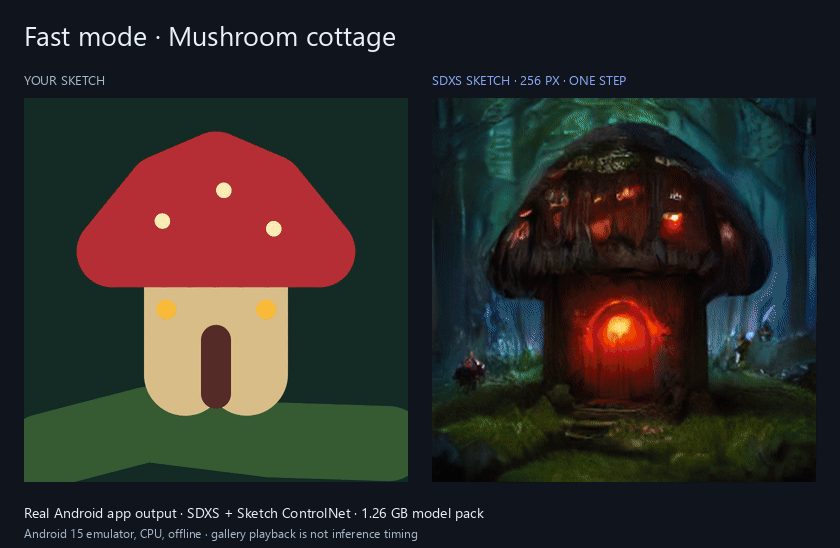
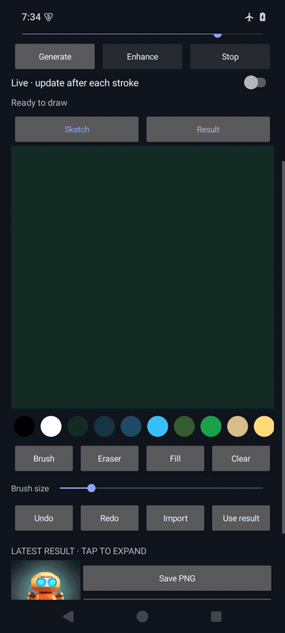
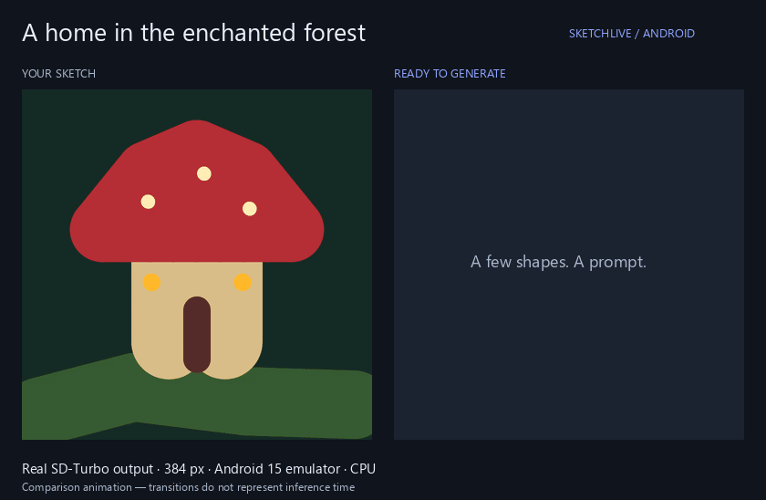
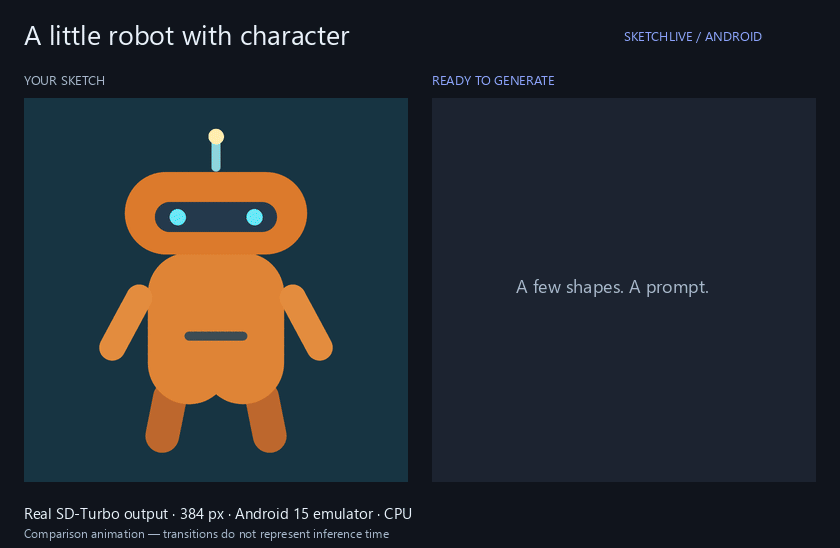
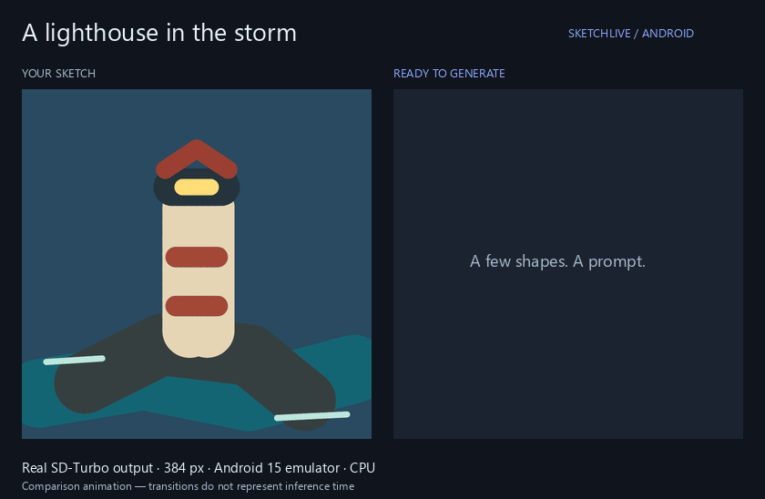
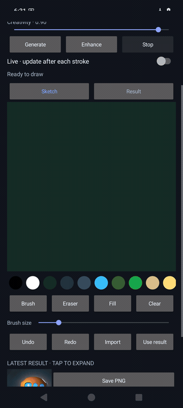

# SketchLive Android

**Draw a few shapes. Describe the scene. Let your phone paint the details.**

Free, open-source sketch-to-image diffusion that runs locally on Android. No desktop server, account, subscription, paid API, or image uploads. Download the model once, then generate in airplane mode.

[**Download the APK**](https://github.com/DylanMartinLSC/sketchlive-android/releases/tag/v0.2.0) · [Build it yourself](#build) · [Desktop project](https://github.com/DylanMartinLSC/sketchlive-krea-alternative)

Android 10+ · 64-bit · 8 GB RAM recommended · Fast 256 px / Quality 384 px · fully offline after setup

## Fast mode: SDXS with sketch guidance

Select **Fast · SDXS Sketch** for a smaller model pack and 256 × 256 one-step generation. Plain SDXS produced usable images but followed the prompt much more than the drawing, so Fast uses its dedicated **Sketch ControlNet** to preserve the shapes.



| | Fast | Quality |
|---|---|---|
| Model | SDXS DreamShaper + Sketch ControlNet | SD-Turbo |
| Output | 256 × 256 | 384 × 384 |
| One-time download | ~1.26 GB | ~2.42 GB |
| Sketch input | Outlines; colors come mainly from the prompt | Full color image-to-image |
| Slider | Sketch guidance: higher follows outlines more strongly | Creativity: higher permits more invention |
| Denoising | Exactly one step | One step, or two with Enhance |

Each mode downloads independently. Existing Quality downloads are reused after upgrading. The app keeps one inference engine loaded at a time. Fast mode has no two-step Enhance; switch to Quality when you want it.

In one **Android 15 x86_64 emulator** run, warm generation took **0.8 s Fast versus 4.3 s Quality** using each mode's settings. This is a single desktop-hosted emulator measurement, **not Galaxy/Pixel FPS or a model-only comparison**. [Results, settings, and limitations](docs/fast-mode.md)

<details>
<summary>Watch Fast mode in the Android app</summary>

<p></p>

Real emulator screenshots, offline generation. Playback is condensed, not a speed benchmark.

</details>

## Quality mode examples

### Mushroom cottage



### Friendly robot



### Stormy lighthouse



These comparisons use **real SD-Turbo output from the Android app**, including the one-step preview and two-step Enhance. The transitions are edited for comparison; they do not represent inference speed. Captured in an **Android 15 x86_64 emulator using CPU inference, with airplane mode enabled**. Physical-phone performance has not been measured.

| Example | Style | Creativity | Seed |
|---|---|---|---|
| Mushroom cottage | Cinematic | 0.90 | 42 |
| Friendly robot | 3D render | 0.85 | 7 |
| Stormy lighthouse | Cinematic | 0.90 | 42 |

[Original input/output PNGs, exact prompts, and recording details](docs/examples/README.md)

<details>
<summary>Watch the actual Android interface</summary>

<p></p>

Actual emulator screenshots: drawing → Generate → Result → Enhance. Playback is condensed and is not a phone performance benchmark.

</details>

## Install and use

1. Install the SketchLive APK on a **64-bit Android 10 or newer** phone. Allow installation from your browser or file manager when Android asks. This is a development preview, not a Play Store release.
2. Choose **Fast** or **Quality** and tap **Download model**. Fast downloads ~**1.26 GB**; Quality downloads ~**2.42 GB**. Use Wi-Fi; allow roughly 3 GB free for Fast or 5 GB for Quality. Files are pinned and verified with SHA-256. Stop pauses the download; Download resumes it.
3. Enter a prompt, choose a style, and draw with your finger or stylus. Use **Generate** for a one-step preview in either mode, or **Enhance** for two denoising steps in Quality mode. Tap Sketch/Result to switch views; the latest-result thumbnail stays below the drawing tools.
4. Enable **Live** to generate after a short pause following each stroke. While inference runs, keep drawing: the next generation uses the newest sketch. Turn off Live or tap Stop to stop automatic work.
5. Save PNG exports to **Pictures/SketchLive**, or share them through Android's share sheet. Import an image through Android's file picker, or use a result as the next sketch.

After setup, generation works in airplane mode. The app never sends sketches, prompts, or generated images to a server. The INTERNET permission is for model-file downloads. Model cards open in your browser only when you request them.

## Content safety

SketchLive follows Google Play's AI-generated content policy:

- **Prompt safeguards.** Descriptions asking for sexual or nude content, anything that sexualizes or endangers minors, sexual violence, graphic gore, self-harm, hate symbols, or deepfakes are refused before inference. The models have no built-in safety checker, so the filter is conservative. It also catches common obfuscations such as `n.u.d.e` or `s3xy`. See [`ContentSafety`](core/src/main/java/dev/sketchlive/core/ContentSafety.java).
- **In-app reporting.** Tap **Report** under the result, or long-press the image. Reporting removes the image and blocks that description on the phone. You can also email the details (no image) to the developer.
- **First-run rules.** The content rules are shown and accepted before the first download.
- **Memory checks.** Phones below about 4 GB (Fast) or 6 GB (Quality) of RAM get a warning before downloading. If Android closes the app mid-generation, the next launch explains why and offers Fast.

[Privacy policy](PRIVACY.md) · [Play release checklist](RELEASING.md)

## What to expect

- **Fast: 256 × 256. Quality: 384 × 384.** Both decode with tiny TAESD. Quality encodes the color sketch; Fast conditions on sketch outlines. Enhance is available only in Quality and still uses TAESD, rather than the desktop app's full VAE.
- **8 GB RAM or more recommended.** The app uses CPU inference for broad compatibility, not a device-specific NPU SDK. The FP16 model packs are about 1.26 GB (Fast) or 2.42 GB (Quality); inference also needs working memory. Low-memory phones may be unable to run the model.
- **Live means asynchronous updates, not a promised frame rate.** First inference loads the model. Subsequent generations reuse the diffusion session. Speed, heat, and battery use depend on the device; this is not the desktop RTX 3090 experience.
- In Quality, Creativity controls the actual diffusion noise level: lower values follow the sketch more closely; higher values allow more invention. In Fast, Sketch guidance controls the ControlNet conditioning strength: higher values follow outlines more strongly. Neither is an image filter. Fixed seeds stabilize results on the same runtime. Java and Python use different Gaussian RNGs, so the same numerical seed does not reproduce desktop pixels.
- Brush, stylus pressure, eraser, size, palette, fill, clear, undo/redo, image import, style presets, seed/reroll, live preview, Stop, Enhance, result reuse, PNG save/share, and an in-session history strip are included.
- The sketch, latest result, and settings are restored after reopening. Up to eight recent results are kept in memory during a session. Export anything you want to keep permanently. Leaving the app cancels generation to avoid unintended background compute. Downloads continue while the process is alive, but are not a background service; interrupted downloads can be resumed.
- Models and private drafts are removed when the app is uninstalled. No analytics or ads are included.

## Build

Install JDK 17+ and Android SDK Platform 35 / Build Tools 35.0.0. Set `ANDROID_HOME` to your SDK directory, or put `sdk.dir=/path/to/sdk` in an untracked `local.properties` file.

```sh
git clone https://github.com/DylanMartinLSC/sketchlive-android.git
cd sketchlive-android
./gradlew :app:assembleDebug :app:lintDebug :core:test
# Windows: .\gradlew.bat :app:assembleDebug :app:lintDebug :core:test
```

APK: `app/build/outputs/apk/debug/app-debug.apk`. The preview is signed with the build machine's Android debug key. Keep the same signing key to install upgrades without uninstalling and losing downloaded models. For distribution, configure your own release signing key; do not commit it.

`core` is a plain Java library shared by the Android app and desktop JVM tests. It implements byte-level CLIP BPE, TAESD preprocessing, SD-Turbo's scaled-linear noise schedule, fixed-seed Gaussian noise, and Euler denoising. The app uses the full ONNX Runtime Android AAR, because these graphs need diffusion operators that aren't included in arbitrary reduced-runtime builds.

### Test real inference on a development computer

The optional integration test runs the **same Java inference code** used on Android against the real models. It writes the input, preview, and enhanced result to `core/build/reports/` for inspection. It requires enough host RAM for CPU inference.

```sh
python tools/download_models.py /path/to/quality-models
python tools/download_models.py /path/to/fast-models --mode fast
./gradlew :core:test -DmodelDir=/path/to/quality-models -DfastModelDir=/path/to/fast-models --rerun-tasks
```

Without the corresponding `modelDir` / `fastModelDir`, unit tests run and real-model integration tests are explicitly skipped. A successful JVM integration test is not an Android hardware performance benchmark.

### Validation for this preview

- APK build and Android lint completed successfully.
- Six JVM tests passed with both real model packs: SD1/SD2 tokenization and padding, scheduler math, sketch preprocessing, deterministic Fast inference, input-dependent conditioning, Quality preview/Enhance, and rejection of unsupported Fast enhancement.
- Android 15 x86_64 emulator tests exercised a resumed HTTPS model download and SHA-256 verification, drawing/fill/undo/redo, actual image generation through the Activity with airplane mode enabled and Wi-Fi disabled, Sketch/Result switching, and successful PNG export to MediaStore.
- Fast-mode Android tests also passed independent mode switching, one-step inference, Stop/restart, guidance persistence, and resumed GitHub model download/checksum verification. All three Fast gallery examples were generated through the actual Android Activity in airplane mode.
- v0.3.0 (targetSdk 36) was tested on an Android 16 x86_64 emulator with 8 GB RAM:
  - real in-app Fast download with pause and resume
  - Fast generation (4.4 s first run); Quality Generate (7.8 s) and Enhance (5.4 s), peaking at about 1.8 GB of process memory
  - blocked prompts, the report flow, report persistence across restarts, rotation, and Save PNG
  - every visible touch target is at least 48 dp
- On a 2 GB Android 15 emulator, Android's low-memory killer ends the process during Quality inference. The app now warns before this and explains it afterwards.
- In the installed release build (Play-style splits), these were tested:
  - a full in-app Fast download
  - offline generation in airplane mode (1.6 s first run, 0.8 s warm)
  - Live updates while drawing
  - Stop mid-inference, which shows "Generation stopped" and keeps the model loaded for a 1.0 s restart
  - pausing a download
  - an upgrade install that keeps downloaded models
- The signed release App Bundle was built and installed through `bundletool` splits. Estimated Play download is about 10.7 MB on arm64, compared with the 59 MB universal APK. Native libraries are 16 KB page-aligned.
- ARM64 native libraries are included in the APK. **Physical ARM Android phone speed, memory use, and thermal behavior have not been measured.** The emulator runs on a desktop CPU and does not predict phone frame rates.

The optional Android integration tests in `app/src/androidTest` expect the verified 384 px model pack in the test app's `no_backup/sd-turbo-v1` directory and the integration input at `files/fixture.png`. A verified pack has the `verified-30015d1ff375a67d2ade66f9a43339adf5cd5639` marker written by the downloader. Fast tests additionally expect the verified pack in `no_backup/sdxs-v1` and `files/fixture-robot.png`; the marker revision comes from `app/src/main/assets/sdxs-manifest.json`. Tests requiring models explicitly skip when setup is incomplete. Run the network download test online; run offline generation in airplane mode after setup. Gradle's connected-test cleanup may uninstall the target and remove its private models, so developers testing multiple stages should install the test APK and use `adb shell am instrument` directly to preserve setup.

## Model provenance and licenses

App source: [MIT](LICENSE). ONNX Runtime: [MIT](https://github.com/microsoft/onnxruntime/blob/main/LICENSE). Gson: [Apache 2.0](https://github.com/google/gson/blob/main/LICENSE). TAESD: [MIT](https://huggingface.co/madebyollin/taesd). SD-Turbo weights retain [Stability AI's model license](https://huggingface.co/stabilityai/sd-turbo/blob/main/LICENSE); downloading the conversion does not grant extra rights to the weights.

The pinned Android conversion is [`xay2001/sd-turbo-android`](https://huggingface.co/xay2001/sd-turbo-android), revision `30015d1ff375a67d2ade66f9a43339adf5cd5639`, folder `sd-turbo-v1`. Its manifest records exact lengths and SHA-256 hashes. Only the 384 px graphs and their shared weight files are downloaded. The CLIP vocabulary/merges come from SD-Turbo revision `b261bac6fd2cf515557d5d0707481eafa0485ec2`; token IDs use SD2's PAD=0 convention.

The app deliberately does not bundle or redistribute model weights inside its APK. Setup links to the upstream model license before download.

Fast uses [`IDKiro/sdxs-512-dreamshaper`](https://huggingface.co/IDKiro/sdxs-512-dreamshaper), revision `76f720262bb051da75666b22c902a78c8e16c763`, with [`IDKiro/sdxs-512-dreamshaper-sketch`](https://huggingface.co/IDKiro/sdxs-512-dreamshaper-sketch), revision `cd341678087336ed72c05660ac84d765896b48e7`. These declare OpenRAIL++ terms; upstream DreamShaper, TAESD, and CLIP terms remain applicable. This app's conversion changes format/precision and fuses the drawing graph; it does not train a new model. Source cards, notices, and license texts accompany both the APK and downloaded Fast pack. Model licenses can be read offline in About.

The [Fast model pack](https://github.com/DylanMartinLSC/sketchlive-android/releases/tag/sdxs-sketch-v1) has SHA-256-pinned files. `tools/export_sdxs.py` documents the 256 px export; it requires PyTorch, Diffusers, Transformers, Accelerate, ONNX, and a CUDA GPU. The Fast tokenizer uses SD1 PAD=49407 and 768-wide text embeddings; Quality uses SD2 PAD=0 and 1024-wide embeddings. They are not interchangeable.
